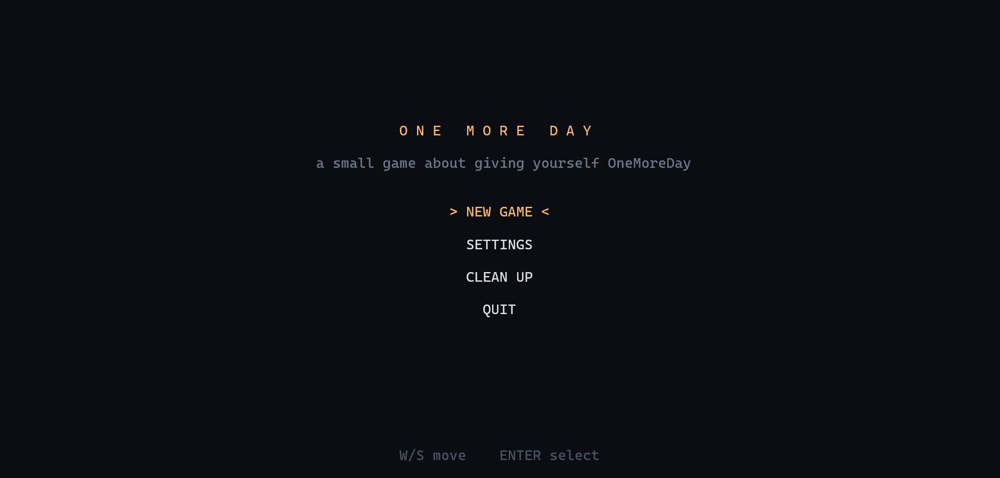
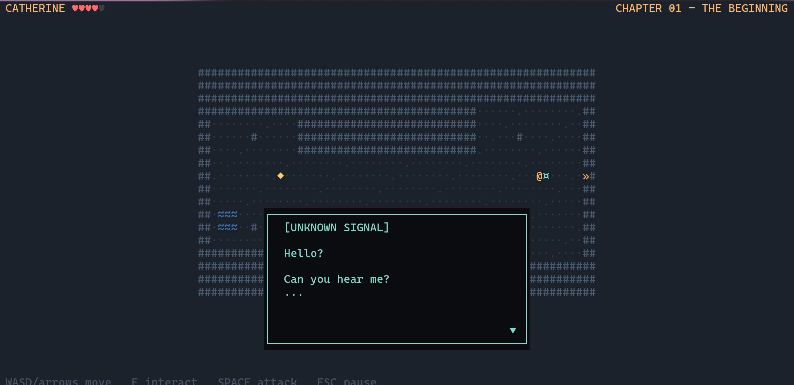

# ONE MORE DAY

*ONE MORE DAY* is a narrative-driven adventure game played within a terminal. You accompany Catherine through a quiet, surreal world—a world that seems to be reaching out to her.

This is a short story about fear, exhaustion, the things we cannot yet name, and the reasons to grant ourselves just one more day. The game does not ask you to be a hero; sometimes, simply carrying on is enough.

## The Story

Catherine wakes up in an unfamiliar place, with no clear sense of where she is headed. A mysterious signal begins to echo, guiding her through places that once filled her with dread—along deserted paths and past gates that cannot be opened by conventional means.

The sender of the signal seems to know Catherine well. They know she has been here before, that she is fleeing from something, and they constantly urge her not to stop too soon. Yet, as she travels further, Catherine realizes that the signal is doing more than just showing the way; it is raising questions about memory, time, and her own identity.

This world operates by its own rules—some of which can be broken. Things that seem to lie beyond the screen may be closer than you think. And somewhere ahead, someone is waiting for Catherine to arrive.

You must discover the answers for yourself:

- Who is sending the signal?
- Why must Catherine keep moving forward?
- Is there truly only one way to navigate this world?
- When everything comes to an end, will she choose to move on, or to stay?

Take your time. Rest if you need to. And if today feels like an overwhelming struggle, remember: sometimes, the most important thing you can do is simply give yourself **one more day**. 

## Installation
- Ensure you have [PowerShell 7](https://apps.microsoft.com/detail/9MZ1SNWT0N5D?hl=en-us&gl=VN&ocid=pdpshare) installed.
- Download this repository and extract its contents.
- Run the `start.bat` file to begin playing.

## System Requirements
- The game currently only runs on Windows (Windows 11 is recommended).
- Any CPU is supported.
- No GPU is required.